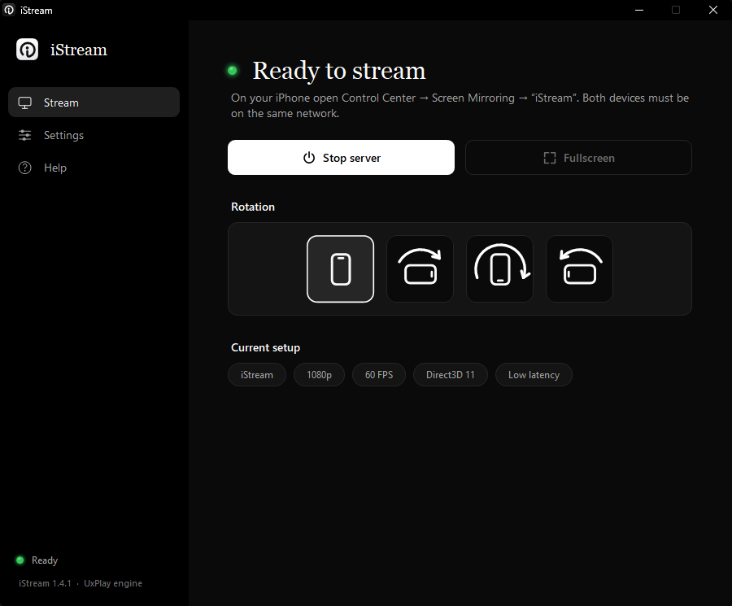
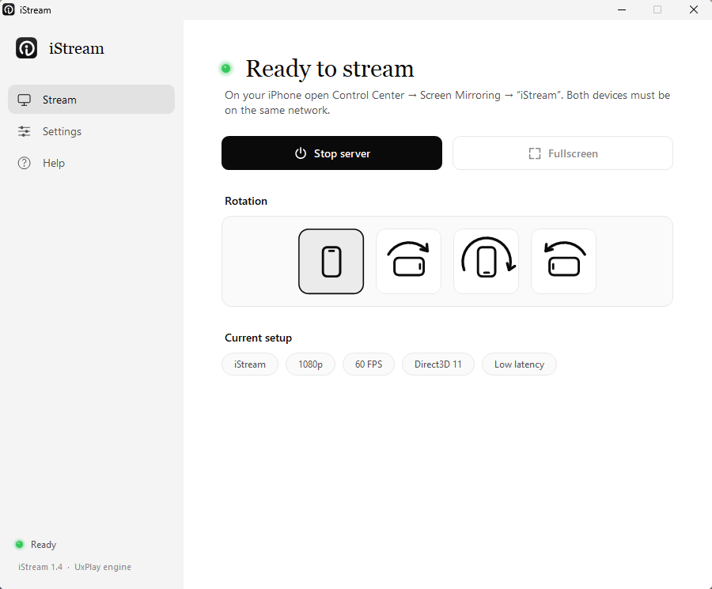
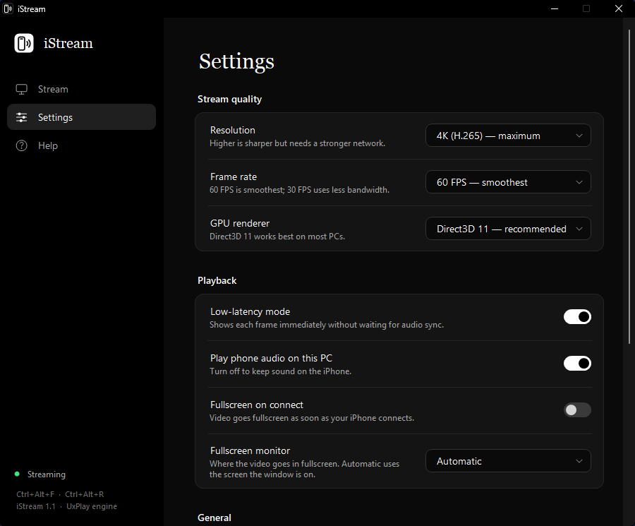
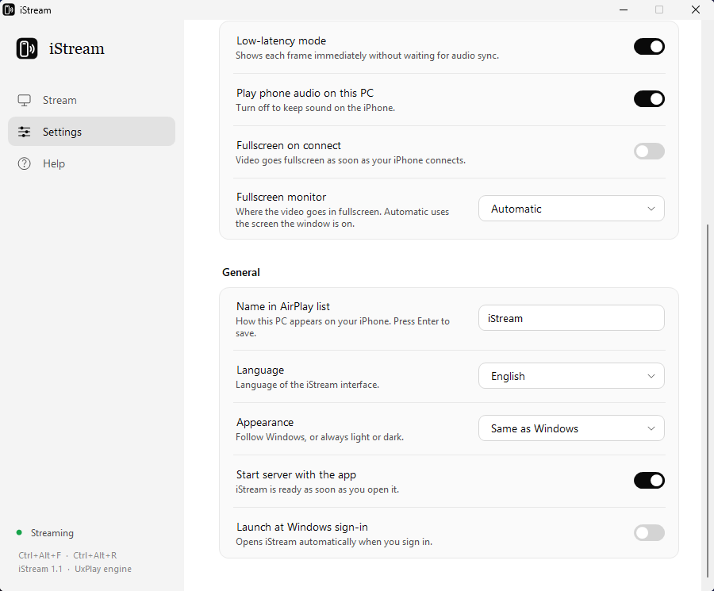
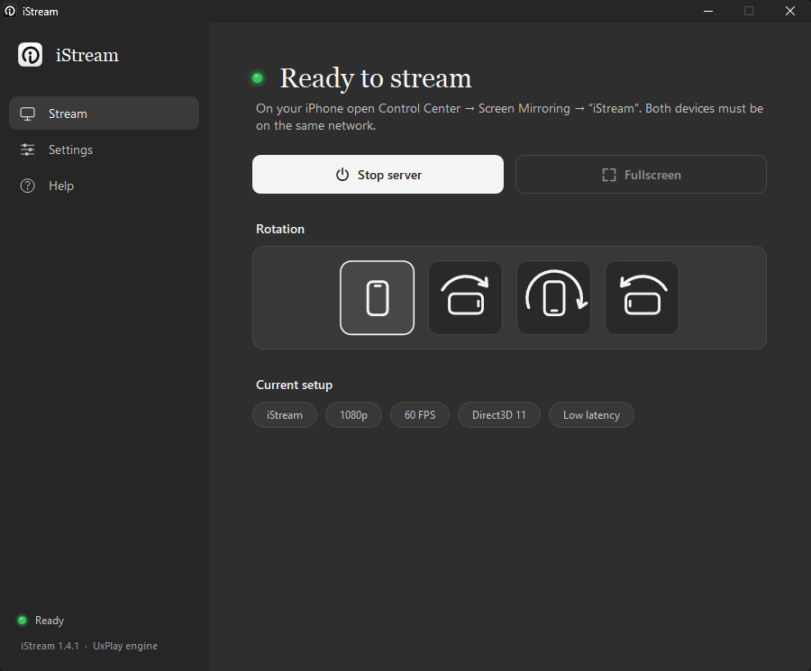

# iStream

**Free, open-source AirPlay screen mirroring for Windows.** Mirror your iPhone or iPad to your PC with low latency, 60 FPS and full GPU decoding. One-click installer, no account, no ads.

<p align="center">
  
  
</p>

<p align="center">
  <a href="https://github.com/olehnykorovych/iStream-AirPlay/releases/latest"></a>
  <br>
  <sub>Windows 10 and 11 · 64-bit · free and open source</sub>
</p>

---

## Features

- **Low latency.** Decoding, rotation, colour conversion and display all run on the GPU (Direct3D 11 or 12), so frames never go back to system memory. On an RTX 3060 a 1080p frame takes under 3 ms on the PC side.
- **60 FPS.** The underlying engine asks the phone for 30 FPS by default; iStream asks for 60.
- **Up to 4K** with H.265, or 720p / 1080p / 1440p if you'd rather save bandwidth.
- **Fullscreen in one keystroke** (`Ctrl+Alt+F`), on the monitor of your choice, or automatically when your iPhone connects.
- **Rotation** by 90°, 180° or 270°, done on the GPU.
- **Settings never cut your stream.** Changes that need the iPhone to reconnect (resolution, frame rate, rotation…) are saved and applied when the stream ends. Hit *Apply now* if you want them immediately.
- **Always ready in the background.** Closing the window keeps iStream in the tray, so your iPhone can mirror any time. With *Launch at Windows sign-in* it starts quietly in the tray. Quit from the tray icon's menu.
- **Updates itself.** New versions download in the background and install when nothing is streaming, and iStream picks up where it was (in the tray if it was hidden). Every download is checked against its SHA-256 before it runs. You can also update by hand from *Settings → Updates → Check for updates*.
- **Fast, reliable reconnects.** A new connection takes over instantly, and the server restarts itself if it ever crashes.
- **One-click firewall fix** if Windows is blocking connections.
- **Light, gray and dark themes** (black-on-white, graphite, white-on-black). By default it follows Windows.
- **6 languages:** English, Polski, Deutsch, Español, Français, Українська.
- **Easy install, or portable.** The installer needs no administrator rights and adds iStream to the Start menu; or unzip the portable package and run it. Settings live in `%APPDATA%\iStream`.

## Requirements

- Windows 10 or 11, 64-bit
- Any GPU with Direct3D 11 (modern NVIDIA, AMD or Intel)
- An iPhone or iPad on the **same network** as the PC

## Getting started

1. [Download](../../releases/latest) **`iStream-Setup-X.Y.Z.exe`** and run it.
   Windows SmartScreen may warn you because the app isn't code-signed: click **More info → Run anyway**.
2. Click **Install**. iStream is installed for your account (no administrator rights), added to the Start menu and opened.
3. If a banner says the firewall is blocking iStream, click **Fix firewall** and approve the administrator prompt.
4. On your iPhone open **Control Center → Screen Mirroring → iStream**.

That's it. The status changes to *Streaming* and the video window opens.

**Portable version:** prefer not to install anything? Download `iStream-vX.Y.Z-win-x64.zip` instead, unzip it anywhere and run `iStream.exe`.

**Uninstall:** Windows *Settings → Apps → Installed apps → iStream → Uninstall*. Your settings are kept unless you tick *Also delete my iStream settings*.

**Silent install** (for scripts): `iStream-Setup-X.Y.Z.exe --quiet [--dir "C:\path\iStream"] [--no-desktop] [--no-launch]`.

## Using iStream

| Action | How |
|---|---|
| Toggle fullscreen | `Ctrl+Alt+F` or the *Fullscreen* button |
| Rotate 90° | `Ctrl+Alt+R` or the phone tiles under *Rotation* |
| Stop mirroring | Stop it on the iPhone (Control Center → Screen Mirroring → Stop Mirroring) |
| Hide to the background | Close the window. iStream keeps running in the tray |
| Open or quit from the tray | Click the iStream tray icon to open it; right-click for *Start/Stop server*, *Fullscreen* and *Quit iStream* |
| Change quality | *Settings → Stream quality* (applied on the next connection) |

<p align="center">
  
  
</p>

<p align="center">
  
</p>

### Settings

| Setting | What it does |
|---|---|
| Resolution | 720p (lowest latency), 1080p (recommended), 1440p, or 4K H.265 |
| Frame rate | 60 FPS (smoothest) or 30 FPS (less bandwidth) |
| GPU renderer | Direct3D 11 (recommended) or Direct3D 12 |
| Low-latency mode | Shows each frame immediately instead of waiting for audio sync |
| Play phone audio on this PC | Turn off to keep sound on the iPhone |
| Fullscreen on connect | Go fullscreen as soon as the iPhone connects |
| Fullscreen monitor | Which screen fullscreen uses |
| Name in AirPlay list | How the PC appears on your iPhone |
| Language / Appearance | Interface language; light, gray, dark or same as Windows |
| Update automatically | Download new versions and install them when nothing is streaming. The *Version* row has *Check for updates* (the portable ZIP opens the download page instead) |
| Keep running in the background | Closing the window hides iStream to the tray instead of quitting (on by default) |
| Start server with the app / Launch at Windows sign-in | Be ready without clicking anything; at sign-in iStream starts hidden in the tray |

**Tip:** for the lowest latency, connect the PC by cable and keep the iPhone on 5 GHz Wi-Fi. If the picture stutters, drop to 1080p or 720p.

## Troubleshooting

**The iPhone doesn't show iStream in Screen Mirroring**
- Check that iStream says *Ready to stream* and shows no firewall banner.
- Make sure both devices are on the same network (guest networks and some routers isolate devices).
- Turn Wi-Fi off and on on the iPhone.
- Stop and start the server in iStream.
- Restart the *Bonjour Service* (Task Manager → Services).

**Windows asked about the firewall and I clicked Cancel.** Click *Fix firewall* in iStream. It removes the blocking rules and adds an allow rule for the engine.

**I moved the folder (or switched from the ZIP to the installer) and now it can't connect.** Firewall rules are tied to the file path. Click *Fix firewall* again.

**I can't find the tray icon.** Windows 11 hides new tray icons: click the **^** arrow next to the clock. To keep iStream visible, drag its icon onto the taskbar, or turn it on in *Settings → Personalization → Taskbar → Other system tray icons*.

**There are two tray icons.** The second one belongs to the engine. You can ignore it; iStream controls everything.

## How it works

iStream is a lightweight Windows app (C# / WinForms, no runtime to install) that drives the open-source [UxPlay](https://github.com/FDH2/UxPlay) AirPlay engine, in the Windows build by [leapbtw/uxplay-windows](https://github.com/leapbtw/uxplay-windows).

It configures the engine for minimum latency and builds a GPU-only GStreamer video pipeline:

```
H.264/H.265 from iPhone → h264parse → d3d11h264dec → d3d11upload → d3d11convert (rotation) → d3d11videosink
```

It also supervises the engine process, manages the video window (borderless fullscreen, monitor choice), and keeps engine-level changes pending while a stream is running.

```
iStream/
├─ iStream.exe          the app
├─ engine/              UxPlay engine (uxplay-windows, unmodified)
└─ src/
   ├─ iStream.cs        engine control, firewall, fullscreen, main window
   ├─ Controls.cs       themes, custom controls, vector icons
   ├─ Strings.cs        translations
   ├─ IconArt.cs        app icon
   ├─ Updater.cs        update check, download, SHA-256 check
   └─ Setup.cs          installer and uninstaller
```

## Building from source

Nothing to install: the build uses the C# compiler that ships with Windows (.NET Framework 4.8).

```bat
git clone https://github.com/olehnykorovych/iStream-AirPlay.git
cd iStream-AirPlay
powershell -ExecutionPolicy Bypass -File scripts\get-engine.ps1
build.cmd
```

`get-engine.ps1` downloads the engine from the official uxplay-windows release and checks its SHA-256.

To build the installer, put the portable package at `dist\iStream-vX.Y.Z-win-x64.zip` (the `iStream` folder with `iStream.exe`, `engine\`, `LICENSE`, `THIRD_PARTY_NOTICES.md` and `scripts\README.txt` as `README.txt`) and run `build-setup.cmd`. It embeds that ZIP and a small uninstaller into `dist\iStream-Setup-X.Y.Z.exe`.

**Adding a language:** add a code and name to `L.Codes` / `L.Names` in `src/Strings.cs`, then add one more value to every `A(...)` line.

## Privacy

No telemetry, no accounts. Apart from AirPlay on your local network, the only traffic is the update check: when *Update automatically* is on (the default), iStream asks GitHub's public API for the latest release 30 seconds after it starts and then every 6 hours. It sends nothing about you, just a plain HTTPS request. Turn it off in *Settings → Updates*. You can still click *Check for updates* there whenever you like.

## License

iStream is licensed under the [GNU General Public License v3.0](LICENSE), because it ships with the GPL-3.0 UxPlay engine. See [THIRD_PARTY_NOTICES.md](THIRD_PARTY_NOTICES.md) for the bundled components and their licenses.

AirPlay, iPhone and iPad are trademarks of Apple Inc. iStream is an independent project and isn't affiliated with or endorsed by Apple.
