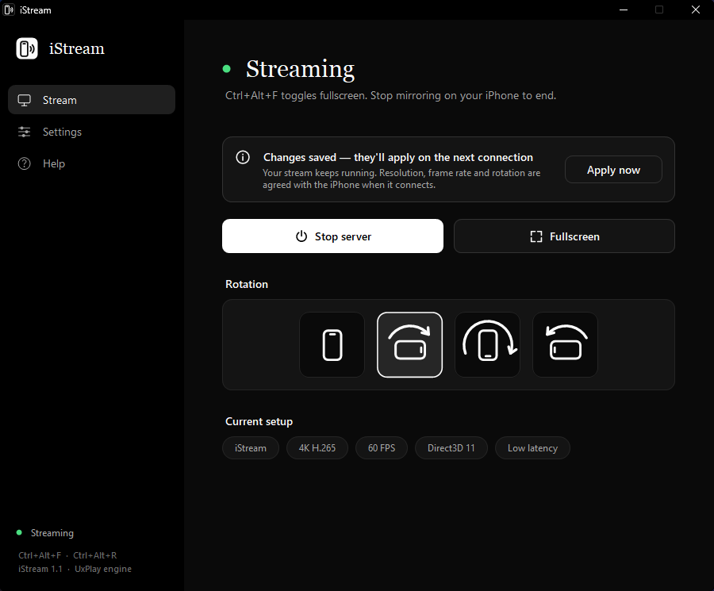

# iStream (po polsku)

**Darmowe klonowanie ekranu iPhone'a i iPada na komputer z Windows przez AirPlay.** Niskie opóźnienie, 60 FPS, dekodowanie na karcie graficznej. Instalacja jednym kliknięciem, bez konta, bez reklam.

**[⬇ Pobierz najnowszą wersję](../../releases/latest)** · [English](README.md)

## Co potrafi

- **Niskie opóźnienie.** Dekodowanie, obrót, konwersja kolorów i wyświetlanie działają w całości na GPU (Direct3D 11/12). Na RTX 3060 klatka 1080p zajmuje komputerowi poniżej 3 ms.
- **60 FPS** zamiast domyślnych 30 w silniku.
- **Do 4K** (H.265) albo 720p / 1080p / 1440p.
- **Pełny ekran** skrótem `Ctrl+Alt+F`, na wybranym monitorze albo automatycznie po połączeniu.
- **Obrót** o 90°, 180° i 270°, wykonywany na GPU.
- **Zmiana ustawień nie przerywa streamu.** Zmiany wymagające ponownego połączenia są zapisywane i stosowane po zakończeniu streamu, a przycisk *Apply now* stosuje je od razu.
- **Naprawa zapory jednym kliknięciem.**
- **Jasny i ciemny motyw** (biało-czarny i czarno-biały), domyślnie jak w Windows.
- **6 języków**, w tym polski (Settings → Language).
- **Instalator bez uprawnień administratora** (skrót w menu Start, deinstalacja w Ustawieniach Windows) albo **wersja przenośna** w ZIP-ie.

## Jak zacząć

1. [Pobierz](../../releases/latest) plik **`iStream-Setup-X.Y.Z.exe`** i uruchom go. Jeśli SmartScreen ostrzeże, że aplikacja nie jest podpisana, kliknij **Więcej informacji → Uruchom mimo to**.
2. Kliknij **Zainstaluj**. iStream zainstaluje się dla Twojego konta (bez uprawnień administratora), pojawi się w menu Start i od razu się uruchomi.
3. Jeśli pojawi się pasek zapory, kliknij **Fix firewall** i zatwierdź okno administratora.
4. Na iPhonie: **Centrum sterowania → Klonowanie ekranu → iStream**.

Telefon i komputer muszą być w tej samej sieci.

**Wersja przenośna:** zamiast instalatora pobierz `iStream-vX.Y.Z-win-x64.zip`, rozpakuj i uruchom `iStream.exe`.

**Odinstalowanie:** Ustawienia Windows → Aplikacje → Zainstalowane aplikacje → iStream → Odinstaluj.

## Skróty

| Co | Jak |
|---|---|
| Pełny ekran | `Ctrl+Alt+F` |
| Obrót o 90° | `Ctrl+Alt+R` albo kafelki z telefonem |

## Gdy iPhone nie widzi komputera

- Sprawdź, czy iStream pokazuje *Ready to stream* i nie ma paska zapory.
- Upewnij się, że oba urządzenia są w tej samej sieci (sieci dla gości często izolują urządzenia).
- Wyłącz i włącz Wi-Fi na iPhonie, a potem zatrzymaj i uruchom serwer w iStream.
- Zrestartuj usługę *Bonjour Service* (Menedżer zadań → Usługi).
- Po przeniesieniu folderu kliknij *Fix firewall* jeszcze raz, bo reguła zapory jest przypisana do ścieżki pliku.

## Licencja

GPL-3.0, tak jak silnik [UxPlay](https://github.com/FDH2/UxPlay), z którego korzysta iStream. Szczegóły są w plikach [LICENSE](LICENSE) i [THIRD_PARTY_NOTICES.md](THIRD_PARTY_NOTICES.md).
AirPlay, iPhone i iPad to znaki towarowe Apple Inc. iStream nie jest powiązany z Apple.
